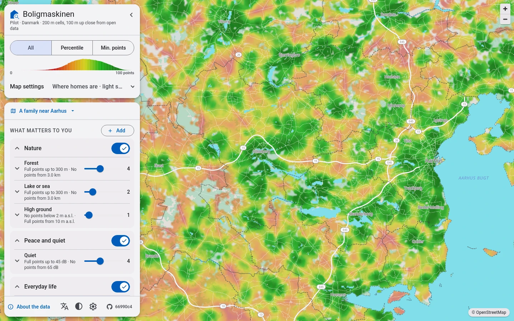
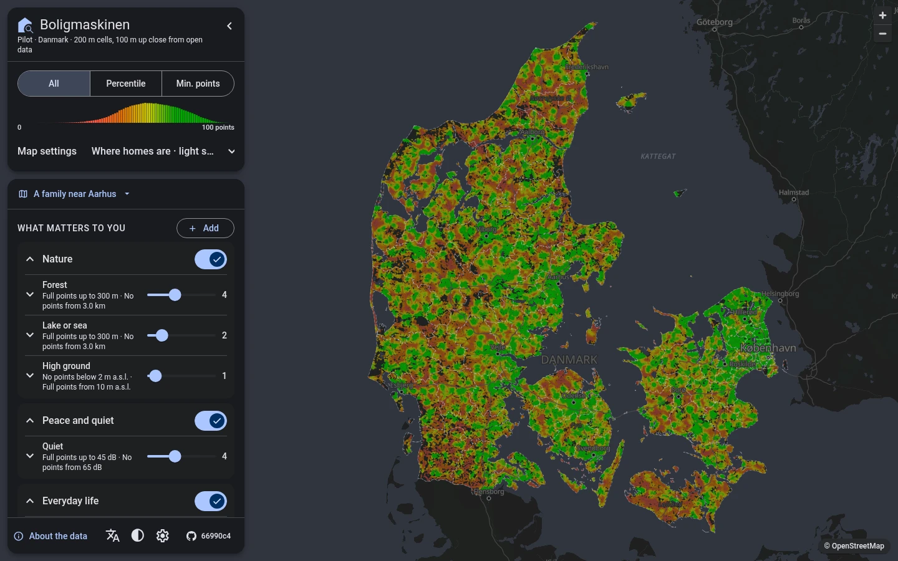
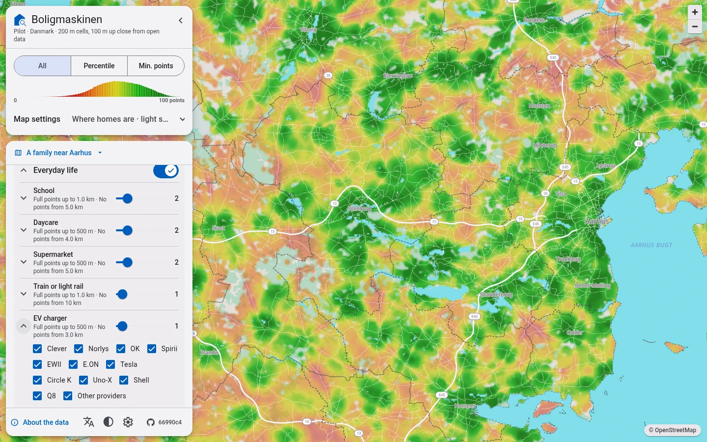
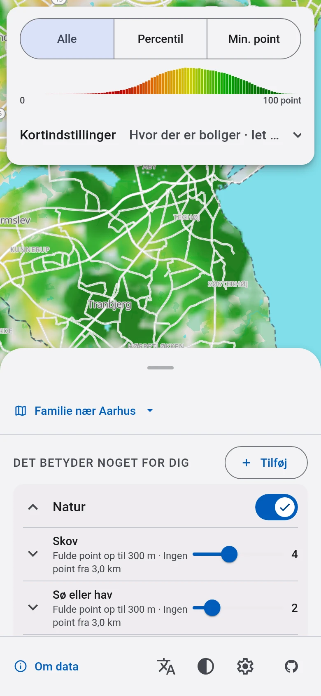
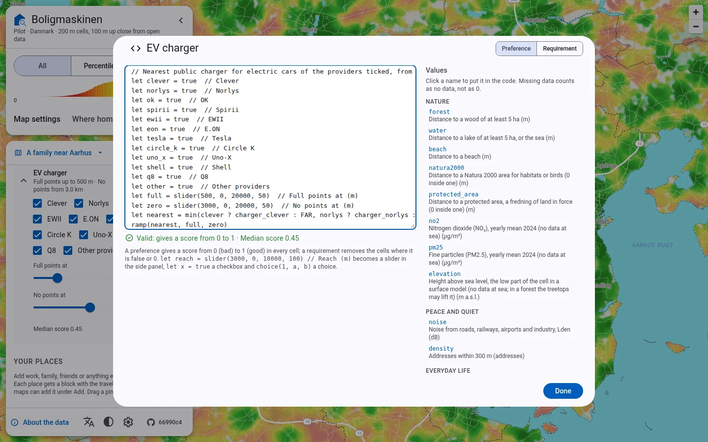
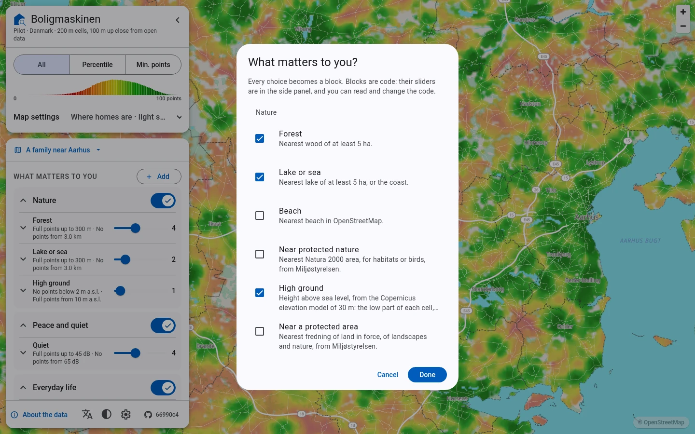
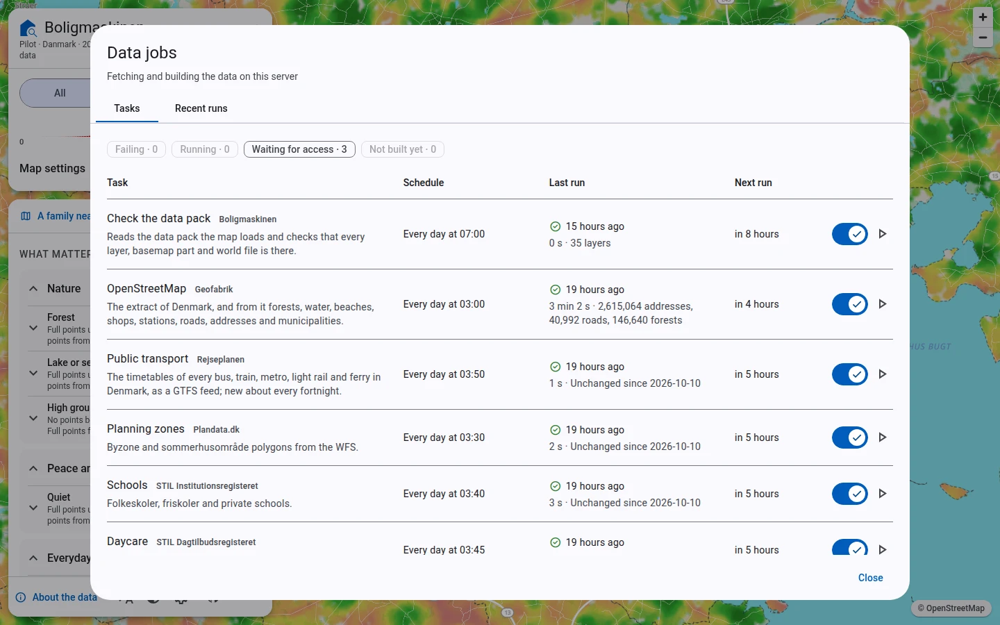

# Boligmaskinen

[](https://github.com/slimcdk/boligmaskinen/actions/workflows/ci.yml?query=branch%3Amaster)
[](https://github.com/slimcdk/boligmaskinen/actions/workflows/ci.yml?query=branch%3Amaster)
[](https://github.com/slimcdk/boligmaskinen/actions/workflows/ci.yml?query=branch%3Amaster)
[](#ci-and-releases)
[](https://github.com/slimcdk/boligmaskinen/pkgs/container/boligmaskinen)
[](https://github.com/slimcdk/boligmaskinen/commits/master)

A self-hosted, map-first home search for Denmark. A full-screen map shows how well every place
fits what you care about. You say what that is with blocks: small formulas over open data, whose
numbers become sliders.



**Status:** prototype. It covers all of Denmark with 37 layers of open data on a 100 m grid, in
Danish and English, and keeps several maps of blocks. Its data jobs fetch the sources and build
the data themselves, every night, and find the travel times to your places on OpenStreetMap's
roads and Rejseplanen's timetables. Still to come: data about homes and homes for sale
([milestones 4 and 5](docs/plan.md#milestone-4-homes)), which wait for access to their sources,
and a first release. [The plan](docs/plan.md#where-we-are-2026-10-10) says
where it stands.

| Folder | What it is |
|---|---|
| [`frontend/`](frontend/README.md) | Angular 22 + Angular Material app: the map, several saved maps, the blocks in groups and their code, the data jobs, light and dark mode, on phones too. Vitest and Playwright tests. |
| [`backend/`](backend/README.md) | Node 24 + Fastify server that serves the frontend, the data pack and the API. |
| [`packages/engine/`](packages/engine/README.md) | The scoring engine and the block language, shared by the frontend and the backend. |
| [`pipeline/`](pipeline/README.md) | The Python steps that build the grid and the data pack from the open data, for all of Denmark or a region. The app image runs them. |
| [`docs/`](docs) | [The development plan](docs/plan.md), [the block language](docs/block-language.md), [block ideas](docs/block-ideas.md), [data sources and how they are fetched](docs/data-sources.md), [public data to add](docs/public-data.md), [Plandata's themes](docs/plandata.md), [OpenData.dk's datasets](docs/opendata-dk.md), [Danmarks Statistik's tables](docs/dst.md), [findings](docs/findings.md), [benchmarks](docs/benchmarks/weighting/README.md), [the architecture decisions](docs/adr/README.md), and the guides to [adding a data source](docs/guides/adding-a-data-source.md) and [adding a weighting](docs/guides/adding-a-block.md). |
| [`.devcontainer/`](.devcontainer) | The development environment: Node 24, uv, go-pmtiles, Playwright's Chromium and psql, next to a PostGIS database. |

## Screenshots

<table>
  <tr>
    <td width="38%" valign="top"><br>All of Denmark, in dark mode</td>
    <td width="38%" valign="top"><br>A block's sliders and checkboxes: whose chargers count</td>
    <td width="24%" valign="top" rowspan="2"><br>On a phone, in Danish</td>
  </tr>
  <tr>
    <td width="38%" valign="top"><br>A block's code, in the block language</td>
    <td width="38%" valign="top"><br>What matters to you: the predefined blocks</td>
  </tr>
</table>

They are taken of the test instance by `npm run screenshots` in `frontend/` (see its README).

## Getting started

The easiest way is the dev container: open the repository in VS Code and pick "Reopen in
Container". It installs every dependency and starts PostGIS (`DATABASE_URL` is set).

```sh
cd frontend
npm install
npm start            # http://localhost:4200, with the data pack in public/data-pack (see frontend/README.md)
npm test             # Vitest
npm run e2e          # Playwright, with the test data pack in e2e/data-pack
```

Without the dev container, Node 24 is needed (`frontend/.nvmrc`), and uv for the pipeline.
[`CONTRIBUTING.md`](CONTRIBUTING.md) says how changes go in, and points to the decisions and the
guides.

## Running it

One image runs the whole app: the backend serves the frontend, the data pack and the API on
port 8080, and runs the data jobs. PostGIS runs next to it. `compose.yaml` starts both;
[`docs/self-hosting.md`](docs/self-hosting.md) is the full guide (install, settings, updates,
backups, troubleshooting), and [`CHANGELOG.md`](CHANGELOG.md) has the release notes:

```sh
echo "POSTGRES_PASSWORD=$(openssl rand -hex 16)" > .env
mkdir data                           # as the user the app runs as, uid 1000 by default
docker compose up -d                 # http://localhost:8080
```

- **The data builds itself.** A new install has no data. At its first start the jobs fetch every
  source, and the grid, the basemap and the data pack follow; for all of Denmark that takes about
  ten minutes. The data jobs (the gear in the panel) show how far they are.
- **What it needs:**
  - about 1 GB of downloads the first time;
  - 5 GB of disk in `./data`;
  - about 1 GB of memory while the data is built, for a few minutes a night.
- **Settings:** `REGION` and `GRID_CELL_METRES` choose the area and the cell size (see
  `backend/README.md`).
- **The image:** `BOLIGMASKINEN_TAG` picks it. `master` (the default) is the newest build, and a
  release has its version, such as `v0.1.0`.



### Licences

The data comes with duties, which "About the data" in the app lists source by source
([Data sources](#data-sources) below lists them too).

- **Credits.** Every source is credited there, with its licence. OpenStreetMap's credit is also on
  the map until it is first used.
- **The ODbL.** An instance that only its owner uses publishes nothing. One that is open to others
  must offer the database made from OpenStreetMap (the data layers of the pack) or the way it is
  made: the source of `pipeline/` and `backend/src/pipeline/`, as the ODbL 4.6 says.
- **Licence texts.** The data pack serves the licence texts of the map's fonts and icons in
  `licences/`. The app serves those of its own fonts and of its libraries in `/licences/`
  (`docs/data-sources.md`).

### Backups

Every night at 01:30 the job "Back up the database" dumps the database into `./data/backups/`
(pg_dump's custom format; the newest seven are kept). The database holds the maps, the places
and the history of the data jobs; the data pack and the raw archive are rebuilt by the jobs.
Copy `./data/backups/` somewhere else to keep it safe.

Restoring a dump replaces the database:

```sh
docker compose stop app
docker compose exec db dropdb -U boligmaskinen boligmaskinen
docker compose exec db createdb -U boligmaskinen boligmaskinen
docker compose run --rm --no-deps --entrypoint sh app -c \
  'pg_restore --no-owner --no-privileges --dbname "$DATABASE_URL" /data/backups/20261010T013000Z.dump'
docker compose start app
```

The app finds its migrations applied and recreates its job queue at start. The backend's tests
restore a dump this way into an empty database.

## CI and releases

GitHub Actions (`.github/workflows/`):

- **Every push and pull request:** engine tests, frontend unit tests and build, backend tests against
  PostGIS, pipeline tests, the end-to-end tests in Chrome with the test data pack, and the image
  started with `compose.yaml` and checked.
- **Coverage:** the unit tests measure which lines they run, with Vitest's V8 coverage for the
  engine, the frontend and the backend, and coverage.py for the pipeline. Each job's summary
  gives the share.
- **The badges** at the top come from the branch `badges`. After every run on master, the job
  "Badges" writes there the results of the tests and of the image, and the coverage, as
  shields.io endpoint files (`.github/scripts/badges.mjs`). The branch has one commit, which
  each run replaces. A part whose tests fail keeps the coverage it had. Per part:
  
  
  
  
- **The image is scanned** with Trivy for known vulnerabilities that have a fix. The high ones are
  reported in the job's log; a critical one stops the build. (go-pmtiles 1.31.2, the newest, is
  built with an older Go, which accounts for most of the high ones.)
- **Dependabot** proposes updates weekly: npm, the pipeline's uv lock, the GitHub Actions and the
  Docker base images (`.github/dependabot.yml`). CI tests them like any other pull request.
- **Every commit on master that passes:** the image is built once, for amd64 and arm64, and
  pushed as `ghcr.io/slimcdk/boligmaskinen:sha-<commit>`, also tagged `master`. arm64 is built
  under QEMU, so a pull request that changes what goes into the image (the Dockerfile, the
  backend's or the pipeline's packages) also builds it for arm64 and starts it there
  (`arm64.yml`).
- **A published release** (tag e.g. `v0.1.0`) builds nothing. It gives the images of the
  released commit their version with crane: only the version label and `APP_VERSION` change,
  the layers stay the ones that were tested. They are tagged with the version (and
  `<version>-amd64`, `<version>-arm64`) and, unless it is a pre-release, `latest`. The footer then shows the version, which the running
  container reports at `/api/version`.
- **Changes to `.devcontainer/`** build the dev container and check its tools and database.

## Data sources

Everything on the map comes from open data. "About the data" in the app credits each source as it
asks, and [`docs/data-sources.md`](docs/data-sources.md) says how each one is fetched and how
often, and which other sources we have looked at.

| Source | What the map takes from it | Licence |
|---|---|---|
| [OpenStreetMap](https://www.openstreetmap.org) | Forests, lakes, the coast, beaches, solar parks, overhead power lines, airports and airfields, supermarkets, stations, pharmacies, libraries, the chargers for electric cars that GeoFA lacks, roads and paths, address points and municipalities, and the basemap of Denmark (through Protomaps) | [ODbL 1.0](https://www.openstreetmap.org/copyright) |
| [Rejseplanen](https://www.rejseplanen.dk) | The timetables of every bus, train, metro, light rail and ferry (GTFS): the travel times by public transport, and the departures near every cell | [CC BY 4.0](https://creativecommons.org/licenses/by/4.0/) |
| [GEUS](https://doi.org/10.22008/FK2/5OZV7W) | The hardness of the drinking water in the public waterworks' supply areas, from the national borehole database Jupiter | [CC BY 4.0](https://creativecommons.org/licenses/by/4.0/) |
| [GeoFA (GeoDanmark)](https://www.geodanmark.dk/home/vejledninger/geofa/) | The public chargers for electric cars, with who runs each, as the operators and the municipalities report them | [CC BY 4.0](https://www.geodanmark.dk/home/vejledninger/vilkaar-for-data-anvendelse/) |
| [Copernicus DEM](https://registry.opendata.aws/copernicus-dem/) | The height above sea level, from the elevation model GLO-30 of about 30 m, and the shading of the land in the background Terrain | [Copernicus DEM licence (GLO-30)](https://documentation.dataspace.copernicus.eu/APIs/SentinelHub/Data/DEM/resources/license/License-COPDEM-30.pdf) |
| [Miljøstyrelsen](https://miljoegis.mim.dk) | Noise from roads, railways, airports and industry, from the strategic noise mapping 2022 (Lden) | [CC BY 4.0](https://creativecommons.org/licenses/by/4.0/) |
| [DCE, through Danmarks Miljøportal](https://arealdata.miljoeportal.dk) | Nitrogen dioxide (NO₂) and fine particles (PM2.5): yearly means for 2024 on a 1 km grid, from DCE's model of the air | [CC BY 4.0](https://creativecommons.org/licenses/by/4.0/) |
| [Miljøstyrelsen and the regions, through Danmarks Miljøportal](https://arealdata.miljoeportal.dk) | Fredninger of land in force, the Natura 2000 areas for habitats and birds, the areas the regions' raw material plans set aside for digging, now or later, the building lines around forests, churches, lakes and streams, and the land the regions have mapped as contaminated (V1 and V2) | [CC0 1.0](https://creativecommons.org/publicdomain/zero/1.0/) |
| [Plandata.dk](https://www.plandata.dk) | Planning zones (byzone, landzone and sommerhusområde), the roads and railways the municipal plans lay out, the local plans of the last two years, the zones around businesses and plants, and the district heating areas | [CC BY 4.0](https://creativecommons.org/licenses/by/4.0/) |
| [STIL Institutionsregisteret](https://institutionsregisteret.stil.dk) | Folkeskoler, friskoler and private schools | No licence stated; the register is public |
| [STIL Dagtilbudsregisteret](https://dagtilbudsregister.stil.dk) | Daycare units | No licence stated; the data is free for everyone, says STIL |
| [Energistyrelsen](https://ens.dk/analyser-og-statistik/data-oversigt-over-energisektoren) | Wind turbines in operation, with their height, from the master data register | [Free to use with the source named](https://ens.dk/om-os/datapolitik) |
| [Danmarks Statistik](https://www.statistikbanken.dk) | Income tax and land tax, population, home burglaries, mean disposable income, nursery rates and class sizes per municipality (tables PSKAT, FOLK1A, STRAF22, INDKP101, RES88 and KVOTIEN) | [Free to use with the source named, as CC BY 4.0](https://www.dst.dk/da/presse/kildeangivelse) |
| [Protomaps](https://github.com/protomaps/basemaps) | The basemap of Denmark: tiles made from OpenStreetMap, and the map style | [Tiles: ODbL. Style: CC0. Code: BSD-3-Clause](https://docs.protomaps.com/basemaps/downloads) |
| [ESA WorldCover](https://esa-worldcover.org) | Land cover in the basemap when the map is zoomed out, part of Protomaps' tiles | [CC BY 4.0](https://creativecommons.org/licenses/by/4.0/) |
| [Natural Earth](https://www.naturalearthdata.com) | The world map outside Denmark | [Public domain](https://www.naturalearthdata.com/about/terms-of-use/) |
| [Fonts and icons](https://github.com/protomaps/basemaps-assets) | The map's labels and icons: the Noto fonts and Mapzen's icons | [Noto: SIL OFL 1.1. Icons: MIT](https://openfontlicense.org) |
| [Roboto and Material Symbols](https://fonts.google.com) | The app's own text and icons, served by the app itself, not by Google | [Roboto: SIL OFL 1.1. Material Symbols: Apache 2.0](https://openfontlicense.org) |
